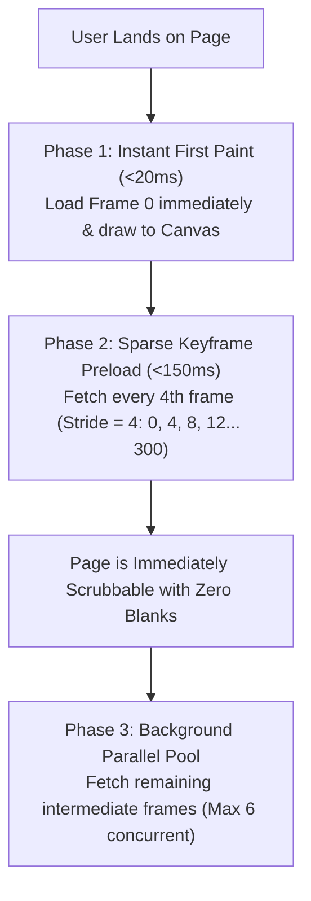
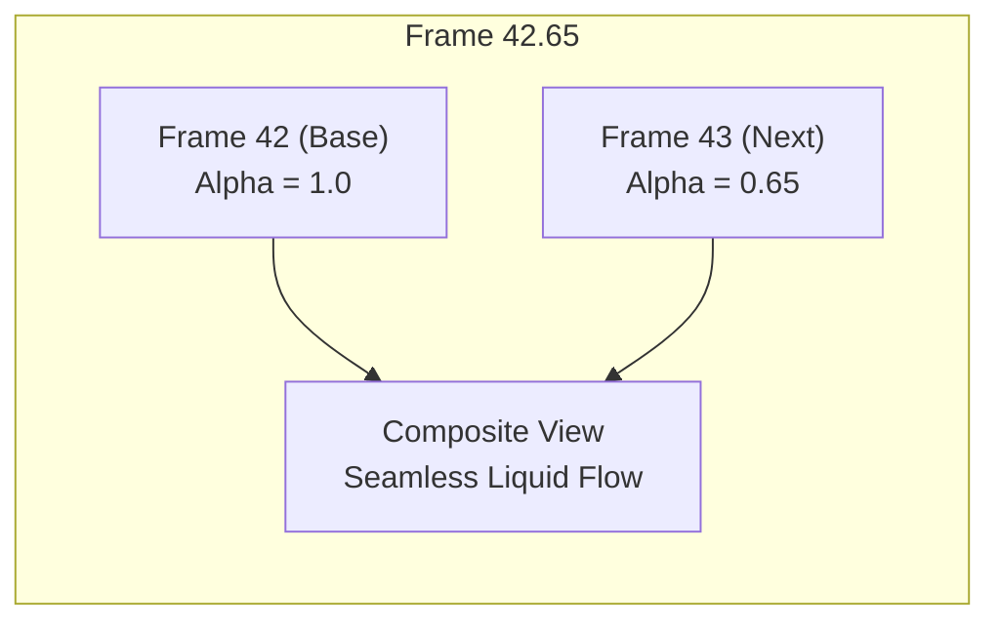

# Cinematic Scroll Canvas Engine: Deep Technical Guide

This document explains the architecture, physics, and rendering mathematics behind the 120 FPS continuous scroll canvas engine used in haute editorial landing pages (such as *"The Awakening of the Velvet Rose"*).

---

## 1. The Fundamental Problem: Why `<video currentTime>` Fails

When developers attempt to build scroll-driven animations, the first instinct is usually:

```javascript
// THE NAIVE APPROACH (DO NOT USE)
window.addEventListener('scroll', () => {
  const progress = window.scrollY / maxScroll;
  videoElement.currentTime = progress * videoElement.duration;
});
```

### Why this produces a broken 8–10 FPS experience:
1. **GOP (Group of Pictures) Encoding**: Video codecs (H.264, HEVC, AV1) do not store independent frames. They store one Keyframe (I-frame) every 1–2 seconds, followed by motion deltas (P-frames and B-frames).
2. **Hardware Decoder Seek Latency**: When `video.currentTime` is changed arbitrarily via a mouse wheel, the browser's hardware video decoder must seek backwards or forwards to the nearest preceding I-frame, then decode all intermediate P/B-frames up to the target timestamp.
3. **Async Seek Queue Saturation**: This seek cycle takes **100ms – 250ms**. In a 60Hz or 120Hz display refresh cycle (8.3ms – 16.6ms), the decoder drops >90% of requests.
4. **Result**: An erratic, stuttering slideshow that feels heavy, laggy, and distinctly amateur.

---

## 2. The Solution: Pre-Extracted WebP Canvas Stream

Instead of asking the GPU to decode compressed temporal deltas in real time, we decouple **decoding** from **playback**:

```
[Raw MP4 / MOV Video]
        │
        ▼ (OpenCV / ffmpeg offline or pre-build step)
[300× 640x640 Compressed WebP Frames (~22KB each)]
        │
        ▼ (Browser Cache / Memory)
[HTML5 2D Canvas Context with Sub-Frame Crossfade]
```

### Bandwidth & Memory Budget:
- **Total Payload**: 300 WebP frames × ~22 KB = **6.6 MB total**.
- A typical hero video background on modern websites streams between 12 MB and 35 MB of video data. A 6.6 MB pre-cached sequence is actually **significantly lighter** and completely immune to streaming buffering.

---

## 3. Two-Phase Progressive Hydration Strategy

Loading 300 images sequentially would cause a long blank delay. We solve this using a three-stage progressive hydration pipeline:



### Nearest-Loaded Fallback Guard
If the user furiously scrolls before background hydration finishes, the engine never draws a blank transparent canvas. The `findNearestLoaded(targetIndex)` algorithm instantaneously falls back to the nearest loaded sparse keyframe:

```javascript
findNearestLoaded(index) {
  if (this.loadedSet.has(index)) return index;
  let delta = 1;
  while (delta < this.totalFrames) {
    if (index - delta >= 0 && this.loadedSet.has(index - delta)) return index - delta;
    if (index + delta < this.totalFrames && this.loadedSet.has(index + delta)) return index + delta;
    delta++;
  }
  return 0;
}
```

---

## 4. Emil Kowalski Spring Physics (Damped Inertia)

A naive canvas implementation updates `currentFrame = targetFrame` immediately. This feels robotic and abrupt.

To mimic real physical momentum (a blooming flower, a heavy mechanical escapement, or an aerodynamic chassis in motion), we introduce an elastic lerp factor ($\lambda = 0.18$):

$$\Delta = \text{targetFrame} - \text{currentFrame}$$
$$\text{currentFrame}_{t+1} = \text{currentFrame}_t + \Delta \times \lambda$$

### Why $\lambda = 0.18$?
- Values $> 0.35$ feel too snappy, losing the cinematic weight.
- Values $< 0.10$ feel sluggish and disconnected from the user's hand.
- $0.18$ provides the perfect organic tension: responsive to scroll velocity, yet gliding to a silky stop with natural momentum.

### GPU Sleep Optimization
To prevent battery drain on laptops and mobile devices, the `requestAnimationFrame` loop self-terminates when the spring settles:

```javascript
if (Math.abs(diff) < 0.005) {
  this.currentFrame = this.targetFrame;
  this.drawFrame();
  this.isRendering = false; // Sleep RAF until next scroll event
  return;
}
```

---

## 5. The Secret Sauce: Sub-Frame Dual-Blend Optical Crossfade

Even with 300 frames, slow scrolling can reveal discrete frame stepping (jumping from frame 42 to 43).

We eliminate this by treating `currentFrame` as a **continuous floating-point scalar** rather than an integer:

```javascript
const baseIndex = Math.floor(currentFrame);
const nextIndex = Math.min(totalFrames - 1, baseIndex + 1);
const blend = currentFrame - baseIndex; // Fractional delta [0.00, 1.00]
```

### Rendering Pipeline:
1. Draw `images[baseIndex]` with `ctx.globalAlpha = 1.0`.
2. Draw `images[nextIndex]` on top with `ctx.globalAlpha = blend`.



This optical crossfade generates intermediate micro-frames on the fly in the canvas compositor, producing an optical illusion of **120 FPS infinite smoothness**.

---

## 6. HiDPI & Retina Sharpness

On Apple Retina displays and high-resolution monitors (`window.devicePixelRatio >= 2`), standard canvas elements look blurry if sized purely in CSS.

The engine scales the internal buffer by DPR while maintaining CSS layout dimensions:

```javascript
setupCanvasDPI() {
  const dpr = window.devicePixelRatio || 1;
  const rect = this.canvas.getBoundingClientRect();
  this.canvas.width = Math.round(rect.width * dpr);
  this.canvas.height = Math.round(rect.height * dpr);
  this.ctx.setTransform(dpr, 0, 0, dpr, 0, 0);
}
```

---

## 7. Performance Checklist for Any Topic

| Parameter | Recommended Setting | Rationale |
| :--- | :--- | :--- |
| **Frame Count** | 240 – 320 frames | Sweet spot between total download size (5–8 MB) and temporal resolution |
| **Format** | WebP (quality 80–84) | 40% lighter than JPEG at identical visual quality, natively supported everywhere |
| **Canvas Dimensions** | 560×560 to 720×720 | Matches hero focal area without bloating RAM on mobile GPUs |
| **Scroll Distance** | 250vh – 350vh | Gives user enough track length to explore details without wrist fatigue |
| **Lerp Factor** | `0.16` to `0.20` | Optimal tactile spring response |
